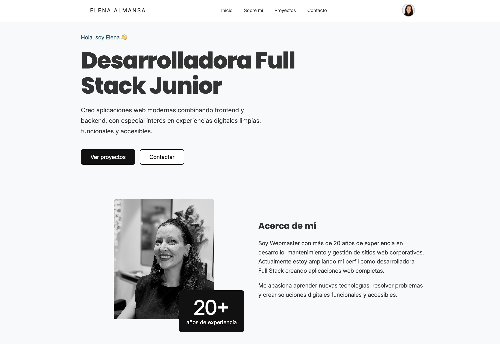

# 💻 Portfolio Frontend - Elena Almansa





## 📌 Descripción

Portfolio personal desarrollado como **Full Stack Developer**, creado con **React + Vite + SCSS** y conectado con una API REST desarrollada con **Spring Boot y PostgreSQL**.

El proyecto representa mi evolución profesional desde más de 20 años trabajando como **Webmaster** hacia el desarrollo de aplicaciones Full Stack modernas.

El objetivo es mostrar mi experiencia, stack tecnológico y proyectos reales mediante una interfaz responsive, limpia y orientada a la experiencia de usuario.


---

# 🚀 Demo

🔗 Próximamente disponible


---

# 🛠️ Tecnologías utilizadas


## Frontend

- ⚛️ React
- ⚡ Vite
- 🎨 SCSS / SASS
- 🔀 React Router DOM
- 🌐 Axios
- 🎯 React Icons
- 📱 Diseño Responsive


## Backend conectado

Este frontend consume una API REST desarrollada con:

- ☕ Java
- 🌱 Spring Boot
- 🔐 Spring Security + JWT
- 🗄️ PostgreSQL


Repositorio backend:

🔗 https://github.com/elenaalmansacampos/mi-portofolio-backend


---

# ✨ Funcionalidades


## 🏠 Home

- Presentación profesional
- Hero section
- Resumen de experiencia
- Stack tecnológico
- Proyectos destacados
- Acceso a contacto


## 👩‍💻 Sobre mí

- Trayectoria profesional
- Experiencia como Webmaster
- Evolución hacia Full Stack Developer
- Fortalezas profesionales
- Tecnologías utilizadas


## 🚀 Proyectos

Los proyectos se cargan dinámicamente desde el backend mediante API REST.

Incluye:

### 🌐 Mundo Tech

Plataforma web de noticias tecnológicas desarrollada con React y Spring Boot.

Tecnologías:

```
React
Java
Spring Boot
PostgreSQL
REST API
SCSS
```


### 💻 Portfolio personal

Portfolio Full Stack con autenticación JWT, gestión de proyectos y arquitectura basada en API REST.


### 🔮 Goddesses Tarot

Aplicación interactiva desarrollada con React, componentes reutilizables y estilos SCSS.


### 🦆 Duckstore

E-commerce frontend con catálogo de productos, carrito y gestión mediante JavaScript.


### 🎮 TicTacToe

Juego interactivo desarrollado para practicar lógica JavaScript y manipulación del DOM.


---

# 📂 Estructura del proyecto


```
src
│
├── assets
│   ├── images
│   └── project
│
├── components
│   ├── button
│   ├── contact
│   ├── experience
│   ├── footer
│   ├── header
│   ├── layouts
│   ├── projects
│   ├── tag
│   └── tech
│
├── pages
│   ├── home
│   ├── about
│   ├── projects
│   ├── contact
│   └── login
│
├── services
│   ├── projectService.js
│   └── authService.js
│
└── styles
    ├── variables.scss
    └── mixins.scss

```


---

# ⚙️ Instalación


Clonar repositorio:

```bash
git clone https://github.com/elenaalmansacampos/portafolio-frontend.git
```


Entrar en la carpeta:

```bash
cd portafolio-frontend
```


Instalar dependencias:

```bash
npm install
```


Ejecutar aplicación:

```bash
npm run dev
```


Disponible en:

```
http://localhost:5173
```


---

# 🔌 Conexión API


Backend:

```
http://localhost:8080
```


Endpoints utilizados:


Obtener proyectos:

```
GET /api/projects
```


Autenticación:

```
POST /api/auth/login
```


---

# 🎨 Diseño


El diseño está basado en una estética minimalista y profesional:


- Mobile First
- Componentes reutilizables
- Arquitectura limpia
- Diseño responsive
- Experiencia de usuario cuidada
- Separación entre lógica y estilos


---

# 📌 Próximas mejoras


- [ ] Deploy frontend
- [ ] Deploy backend
- [ ] Formulario conectado a API
- [ ] Panel administrador de proyectos
- [ ] Mejoras de animaciones UX


---

# 👩‍💻 Autora


## Elena Almansa

**Full Stack Developer | Webmaster**


📍 Barcelona, España


LinkedIn:

https://www.linkedin.com/in/elena-almansa-5315a017/


GitHub:

https://github.com/elenaalmansacampos
